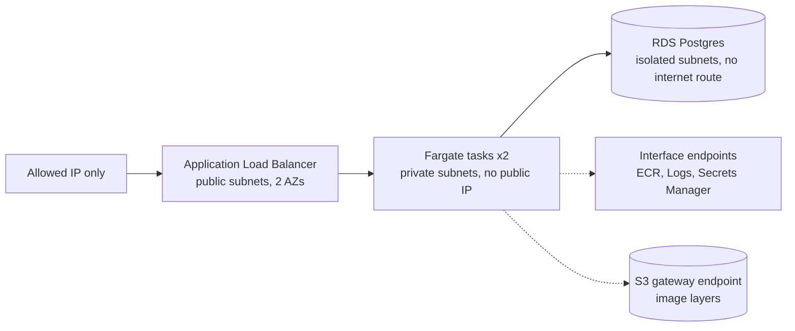
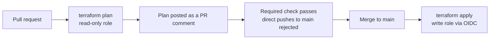

# aws-platform-as-code

A small AWS platform built entirely with Terraform and shipped through a pull-request pipeline. A containerised API runs on ECS Fargate in private subnets behind a load balancer, with a Postgres database in isolated subnets and no stored credentials anywhere.

Everything in the stack was created, tested end to end, and destroyed through the pipeline. Estimated total cost of the build: under $1.

## Architecture

Layered security groups: the load balancer accepts one source IP, the app accepts only the load balancer, and the database accepts only the app. The app can talk only to the database, the endpoints and S3.

## How a change ships

- GitHub Actions assumes AWS roles through OIDC. No access keys exist.
- Pull requests use a read-only role. Only `main` can assume the write role.
- A branch ruleset requires the `plan` check, and a direct push to `main` is rejected.
- State is in S3 with native locking. Applies are serialised by a concurrency group.

## What is built

| Layer | Module | Status |
|---|---|---|
| Remote state, budget alert | `envs/dev` | Live |
| VPC: public, private and database subnets, S3 endpoint | `modules/network` | Live (free) |
| RDS Postgres with a managed password | `modules/database` | Built, tested, destroyed |
| Interface endpoints for ECR, Logs, Secrets Manager | `modules/endpoints` | Built, tested, destroyed |
| ALB and Fargate service | `modules/service` | Built, tested, destroyed |
| SNS email alerts, 4 CloudWatch alarms, overview dashboard | `modules/monitoring` | Built, tested, destroyed |

## Evidence

The service answered through the load balancer, wrote to the database and read it back:

~~~
$ curl -s http://$ALB/health
{"status":"ok"}
$ curl -s -X POST http://$ALB/items -H 'Content-Type: application/json' -d '{"name":"pipeline-built","quantity":3}'
{"id":1}
$ curl -s http://$ALB/items
[{"id":1,"name":"pipeline-built","quantity":3}]
~~~

ECS reported `(service platform-dev-api) has reached a steady state.`

The database after the pipeline created it (status, publicly accessible, encrypted):

~~~
available False True
~~~

The private endpoints, all `available`:

~~~
com.amazonaws.us-east-1.s3              Gateway
com.amazonaws.us-east-1.ecr.api         Interface
com.amazonaws.us-east-1.ecr.dkr         Interface
com.amazonaws.us-east-1.logs            Interface
com.amazonaws.us-east-1.secretsmanager  Interface
~~~

Pipeline timings: service apply 3m57s, and the destroy of 27 resources 5m47s.

## Monitoring

A `monitoring` module adds an SNS topic with an email subscription, four CloudWatch alarms and an overview dashboard, deployed through the same pipeline.

| Alarm | Fires when |
|---|---|
| Unhealthy targets | any API target fails health checks for 2 minutes |
| API 5xx | more than 5 server errors in 5 minutes |
| ECS CPU | the service averages above 80 percent for 3 minutes |
| RDS storage | free database storage drops below 2 GiB |

The dashboard shows requests and errors, response time, healthy and unhealthy targets, ECS CPU and memory, and database CPU, connections and free storage.

To test failure handling, I removed the database ingress rule by hand. The next pull request plan detected the drift (`1 to add`) and the pipeline repaired it in 25 seconds (incident 9).

## Security design

- No stored credentials. OIDC with short-lived role sessions.
- Least-privilege IAM, built iteratively from real AccessDenied errors. Policies are in [`docs/iam`](docs/iam).
- The apply role cannot modify the pipeline's own roles.
- The database password is created and held by RDS in Secrets Manager.
- Tasks have no public IP and no route to the internet.
- Encryption at rest on RDS and in the state bucket. The alert email and allowed IP are sensitive variables from GitHub secrets.

## Cost

| Item | Approx. per hour |
|---|---|
| Network, IAM, state, budget | $0 |
| RDS `db.t4g.micro` plus storage | $0.02 |
| 4 interface endpoints in 2 AZs | $0.08 |
| ALB | $0.02 |
| 2 small Fargate tasks | $0.03 |
| **Whole stack** | **about $0.17** |

A monthly AWS Budget alert is set. Costly layers are removed by deleting their files in a pull request.

## Tear down

Delete `envs/dev/service.tf`, `envs/dev/endpoints.tf` and `envs/dev/database.tf` in a pull request. The plan lists exactly what will be destroyed, and merging runs it. To bring the stack back, restore those files from git history.

## Repository layout

~~~
envs/dev/          root configuration: network, database, endpoints, service
modules/           network, database, endpoints, service
.github/workflows/ plan on pull request, apply on merge
docs/              incident log, design decisions, IAM policies
~~~

## Incidents and decisions

- [Incident log](docs/incident-log.md): 9 real problems, how each was found and fixed.
- [Design decisions](docs/decisions.md): why it is built this way and what I traded off.

## Known limitations

- HTTP only and no application authentication. Production would add ACM and HTTPS, and authentication or a WAF.
- RDS is single-AZ with no backups, so teardown is fast. Production would use Multi-AZ, backups, a final snapshot and deletion protection.
- The read-only plan role cannot detect missing write permissions, so a plan can pass and the apply still fail (incident 6).
- Inline policies on `platform-app-*` roles are not content-limited. A permissions boundary would close this.
- Branch protection requires the plan check but no human approval, because this is a solo repository.
- The bootstrap (state bucket, OIDC provider, the two pipeline roles) was created by hand and is not in this repository.
- GitHub Actions versions emit a Node 20 deprecation warning and need updating.

## Next

Autoscaling, HTTPS, a permissions boundary, and the same workload on EKS.
